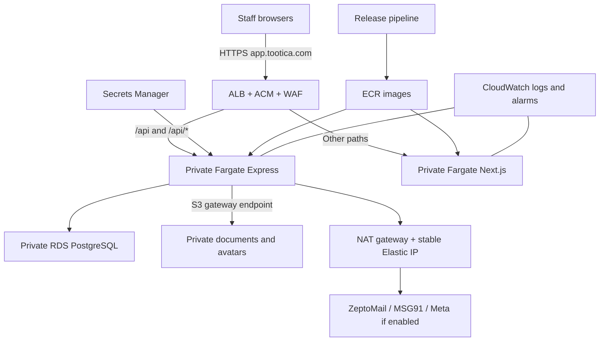

# Tootica: higher-budget Fargate migration reference

> The selected budget launch is now [Lightsail](AWS_PRODUCTION_MIGRATION.md). This document preserves the earlier Fargate alternative.

Updated **10 November 2026**. Scope: **1-3 clinics, up to 50 staff users**, Mumbai (`ap-south-1`). This is a plan and runbook, not an already implemented or deployed AWS stack.

## 1. Recommendation and decision summary

Use **ECS/Fargate for Next.js and Express, RDS PostgreSQL, and private S3**. Keep **ZeptoMail and MSG91**. Serve the UI and API through one HTTPS hostname, such as `app.tootica.com`.

| Item | Estimate |
| --- | --- |
| Managed launch AWS budget | **USD 200-240/month**, approximately **INR 18,000-21,600/month** |
| Normal-use cost model | **USD 188.04/month**, including a USD 15 WAF allowance |
| First month | **USD 270-330**, assuming about 10 days of separate staging and temporary migration resources |
| Engineering effort | **90-110 hours** |
| Fully operational production | **10-15 working days, about 2-3 calendar weeks**, including rehearsal and acceptance |
| Final write freeze | Initially reserve **30-60 minutes**; replace this with the measured rehearsal result |
| Higher availability | **USD 340-400/month**; model USD 314.50 |

INR uses a fixed **INR 90/USD planning assumption**, not a live exchange rate. Taxes, FX/payment fees, engineering, email/SMS/WhatsApp, domain renewal and paid support are extra. No free-tier credits, reserved commitments or Spot discounts are assumed. These estimates are not an AWS quote or uptime guarantee.

The managed launch has one task per service, Single-AZ RDS and one NAT gateway. It requires acceptance of recovery time during a database/AZ incident. If that is unacceptable, fund the higher-availability option before launch.

## 2. Repository findings and required changes

| Area | Current state | Work before production |
| --- | --- | --- |
| Frontend | Next.js 16; relative `/api` calls and development rewrite | Linux image, production build and ALB routing |
| Backend | Express/TypeScript; `src/server.ts` and optional Lambda wrapper | Image, readiness, proxy trust and controlled deployments |
| Database | Docker PostgreSQL 16, Prisma 7 pg adapter | Private RDS, verified TLS, pool limits, runtime/migration roles and tested restore |
| Documents | `src/common/storage/fileStorage.ts` uses disk; controller calls synchronous `exists()` and local stream | Async S3 save/read/exists/delete and updated authorized download flow |
| Avatars | `src/common/storage/avatarStorage.ts` uses disk; `users.avatar_key` stores a key | S3 adapter with existing validation and cleanup |
| OTP | `src/modules/auth/otpStore.ts` is an in-process Map | Persistent shared state and atomic issue/resend/attempt/consume operations |
| Email/SMS | ZeptoMail SMTP and MSG91 OTP integrations | Production secrets and actual delivery tests from AWS; provider IP configuration |
| WhatsApp | Credentials encrypted with `WHATSAPP_TOKEN_ENCRYPTION_KEY` | Preserve encryption compatibility and check configured API version/templates if enabled |
| Automation | No app Dockerfiles, IaC project or production workflow found | Create and review these artifacts |

**Adding environment variables alone does not implement S3 or shared OTPs.** Those switches and adapters still need code. Older AWS documents are Lambda design references, not the current launch runbook.

A Lambda wrapper is not enough for the existing 25 MB document uploads: ordinary synchronous Lambda payloads are limited to 6 MB and API Gateway payloads to 10 MB. A later Lambda architecture needs direct S3 file transfer. [Lambda limits](https://docs.aws.amazon.com/lambda/latest/api/API_Invoke.html), [API Gateway quotas](https://docs.aws.amazon.com/general/latest/gr/apigateway.html).

## 3. Architecture and initial sizing



- VPC across two AZs. Public subnets: ALB/NAT. Private app subnets: tasks. Isolated DB subnets: RDS.
- Start frontend at **0.5 vCPU / 1 GB**, backend at **0.5 vCPU / 2 GB**. The extra backend memory accommodates Sharp and buffered files. Load-test these assumptions; 50 registered users is not a capacity guarantee for 50 concurrent sessions.
- Start RDS at **db.t4g.small, PostgreSQL 16, Single-AZ, 20 GB gp3**, supported minor release, encryption, deletion protection, backups and monitored storage limits.
- Separate ALB IP target groups: `/api` and `/api/*` to port 4000, other routes to port 3000. Preserve `/api`. [ECS ALB guidance](https://docs.aws.amazon.com/AmazonECS/latest/developerguide/alb.html)
- Task inbound only from the ALB security group. RDS 5432 only from backend/migration groups. No public task or RDS IPs.
- One zonal NAT gateway provides outbound access and a stable MSG91 allowlist IP. Its single-AZ dependence is an accepted launch trade-off.
- Add a free S3 **gateway** endpoint to app route tables to avoid sending S3 traffic through NAT. Paid interface endpoints are a different cost choice. [S3 endpoint guidance](https://docs.aws.amazon.com/vpc/latest/privatelink/vpc-endpoints-s3.html)
- Keep the current JWT/role/clinic auth. Cognito migration is out of scope. Bound the long-running pg pools; RDS Proxy is optional when measurements justify it.

## 4. Monthly cost model

Assumptions: 730 hours/month, 5-10 concurrently active staff initially, 20 GB DB storage, 20 GB files including a version allowance, about one average ALB LCU and modest logs/traffic.

| Component | Basis | USD/month |
| --- | --- | ---: |
| Frontend Fargate | 1 x 0.5 vCPU / 1 GB | 18.93 |
| Backend Fargate | 1 x 0.5 vCPU / 2 GB | 22.33 |
| RDS PostgreSQL db.t4g.small | Single-AZ instance | 30.66 |
| DB storage and backup overage | 20 GB gp3 and modest overage allowance | 3.00 |
| Application Load Balancer | 1 ALB x 730 hours | 17.45 |
| ALB traffic | 1 average LCU x 730 hours; not reserved LCUs | 5.84 |
| NAT gateway | 1 gateways x 730 hours | 40.88 |
| NAT data processing | Modest provider and image-pull traffic | 2.00 |
| Public IPv4 | 3 addresses: ALB plus NAT | 10.95 |
| Private S3 storage and requests | 20 GB files/version allowance plus requests | 2.00 |
| Secrets Manager | Small secret set and API requests | 1.50 |
| CloudWatch logs and alarms | Modest traffic and capped retention | 7.00 |
| ECR and AWS build allowance | Small images; non-AWS runner charges excluded | 5.00 |
| Route 53 | One hosted-zone allowance; registration excluded | 0.50 |
| Data transfer | Internet and inter-AZ allowance | 5.00 |
| WAF | Basic ACL/rules and low request volume; premium features excluded | 15.00 |
| **Total model** | Before taxes and external communications | **188.04** |

[Spreadsheet](AWS_FARGATE_COST_REFERENCE.csv) and [machine-readable assumptions](AWS_FARGATE_COST_REFERENCE_2026-11-10.json).

### Pricing inputs and alternatives

Verified Mumbai on-demand rates, checked 10 November 2026:

| Meter | Rate | Primary source |
| --- | ---: | --- |
| Fargate Linux x86 vCPU | USD 0.04256/hour | [ECS regional catalog](https://pricing.us-east-1.amazonaws.com/offers/v1.0/aws/AmazonECS/current/ap-south-1/index.json) |
| Fargate Linux x86 memory | USD 0.004655/GB-hour | Same ECS catalog |
| RDS db.t4g.small PostgreSQL Single-AZ | USD 0.042/hour | [RDS regional CSV](https://pricing.us-east-1.amazonaws.com/offers/v1.0/aws/AmazonRDS/current/ap-south-1/index.csv), SKU `YA9RJG9UAYJKR7G8` |
| RDS db.t4g.small PostgreSQL Multi-AZ | USD 0.084/deployment-hour | Same RDS catalog, SKU `G9TBJHECSCYNG22J`; do not double again |
| Application Load Balancer | USD 0.0239/hour + USD 0.008/LCU-hour | [ELB regional catalog](https://pricing.us-east-1.amazonaws.com/offers/v1.0/aws/AWSELB/current/ap-south-1/index.json) |
| Zonal NAT gateway | USD 0.056/hour | [EC2 regional CSV](https://pricing.us-east-1.amazonaws.com/offers/v1.0/aws/AmazonEC2/current/ap-south-1/index.csv), SKU `DJ4GYZ29AWV3WFQX` |
| Public IPv4 in use | USD 0.005/address-hour | [VPC pricing](https://aws.amazon.com/vpc/pricing/) |

The IPv4 estimate includes two ALB addresses and one NAT EIP. More addresses/gateways increase cost. One average LCU is a traffic assumption, not a minimum capacity reservation. Storage, requests, logs, builds, transfer, NAT bytes and WAF entries are **budget allowances**, not exact regional quotes.

Supporting prices: [Fargate](https://aws.amazon.com/fargate/pricing/), [ALB](https://aws.amazon.com/elasticloadbalancing/pricing/), [RDS](https://aws.amazon.com/rds/postgresql/pricing/), [S3](https://aws.amazon.com/s3/pricing/), [WAF](https://aws.amazon.com/waf/pricing/), [Secrets Manager](https://aws.amazon.com/secrets-manager/pricing/), [Route 53](https://aws.amazon.com/route53/pricing/).

| Option | Monthly AWS budget | Trade-off |
| --- | ---: | --- |
| Budget pilot: one EC2 host + RDS + S3 + TLS reverse proxy | Approximately USD 90-130; indicative allowance, not a verified instance quote | More OS maintenance, one app host, separate deployment/recovery design; fixed IP supports provider allowlisting |
| **Managed Fargate launch** | **USD 200-240** | Managed starting point with accepted Single-AZ/single-NAT recovery risks |
| Two tasks/service, Multi-AZ RDS, two NAT gateways | **USD 340-400**, model USD 314.50 | More resilient across AZ failures; test actual failover |

For the higher-availability option, place at least one task of each service in each AZ, use Multi-AZ RDS, and route each private application subnet through a NAT gateway in its own AZ. Allowlist both NAT Elastic IPs with MSG91 where required. Test failover and retry behavior.

Additional costs and assumptions:

- Monitor burstable DB/EC2 CPU credits, extra task hours, storage/version growth and optional paid WAF features; sustained use can exceed these allowances.
- A full-month duplicate staging environment roughly doubles the relevant infrastructure cost. The first-month budget assumes staging runs for about 10 days and is then removed/resized. Stopping tasks does not stop ALB, NAT, storage or address charges.
- Keep the existing ZeptoMail account and verified `noreply@tootica.com` sender; apply its actual credits/validity/minimum purchase. [ZeptoMail pricing](https://www.zoho.com/zeptomail/pricing/)
- MSG91 follows the account's actual billable-send, resend, route and minimum-wallet prices. A usage scenario is **50 staff x 2 SMS/day x 22 days = 2,200 SMS/month**. Confirm the rate in the account rather than relying on an unverified per-SMS estimate. [MSG91](https://msg91.com/)
- WhatsApp, domain renewal, support and non-AWS CI runner charges are separate.
- At an illustrative INR 1,500/hour, implementation would be **INR 135,000-165,000 one-time**. Use the agreed rate; this is not a contractor quote.
- Rebuild the approved estimate in the [AWS Pricing Calculator](https://calculator.aws/) before provisioning. Add billing alerts at 50%, 80% and 100% of the approved budget.

## 5. Delivery timeline

| Work | Engineer hours | Completion evidence |
| --- | ---: | --- |
| Inventory, release/access decisions and backup plan | 6 | Approved workload/budget, release commit and source backup |
| S3 document/avatar adapters and tests | 12-16 | Files survive task replacement; authorized reads/writes/deletes |
| Shared OTP state and atomic limits/consumption | 12-16 | Works across processes/restarts and concurrent requests |
| Linux images, production config and TLS | 8 | Production-mode image smoke tests |
| IaC, IAM, secrets, monitoring and pipeline | 16-20 | Reproducible staging deployment |
| Database/file migration rehearsal | 8 | Timed import, checksum/key checks and rollback rehearsal |
| Integration/load/restore/clinic acceptance | 12-16 | Accepted test results and capacity measurements |
| Cutover, handoff and initial observation | 6-8 | One writable system and named support owner |
| **Total** | **90-110** | **10-15 working days** |

Indicative order: days 1-4 code preparation; days 4-7 infrastructure/staging; days 7-10 migration, restore and load tests; days 10-15 acceptance/cutover/observation. Tasks can overlap. Account checks, quotas, DNS access, messaging approvals, missing source files or unrelated defects can extend the calendar schedule.

## 6. Phase A: release, accounts and backups

1. Select a reviewed release commit with the intended appointment, treatment, OTP, profile and UI changes. Review uncommitted changes before building and use the normal PR/release process.
2. Decide whether local data is approved production data or demo content. Agree which clinics/users/records to import.
3. Use an organisation-owned AWS account, root MFA and named access. Give CI short-lived OIDC role credentials rather than repository AWS keys.
4. Confirm DNS access and retain existing MX, DKIM and ZeptoMail records. Check service quotas for deployment surges, staging and migration tasks, not only steady-state tasks.
5. Back up PostgreSQL, the resolved `UPLOAD_DIR`, release/migration versions and required encryption keys through protected channels.
6. Generate production JWT secrets, an OTP hashing secret and deletion code; use separate production provider credentials. **Preserve the WhatsApp encryption key for existing ciphertext** until a tested decrypt/re-encrypt migration replaces it. A different key alone makes imported tokens unreadable.
7. Create/change production administrator passwords through a controlled process. Do not launch with development passwords, demo accounts or the default deletion code.
## 7. Phase B: application changes before deployment

### Storage

- Implement local/S3 selection. The proposed `STORAGE_DRIVER`/`S3_BUCKET` switches require code; production should fail startup if S3 configuration is missing.
- Preserve DB object keys: `<clinicId>/<uuid>.<ext>` and `avatars/<userId>/<uuid>.webp`. Do not add an extra bucket prefix without migrating every corresponding reference.
- Change document operations to async S3 calls. Update `src/modules/records/controller.ts`, which currently uses synchronous local `exists()` and streams. Keep clinic authorization and download audit creation.
- Replace `avatarStorage.ts` disk read/save/remove with S3 equivalents. Retain avatar validation, the 2 MB limit, 256 x 256 conversion and replacement cleanup.
- Initially stream documents through the authorized API and retain the 25 MB limit. Direct browser presigned uploads can be a later project.
- Private bucket, Block Public Access, encryption, versioning, TLS-only policy and scoped backend task-role permissions. No static AWS keys in browser/app configuration.
- Test missing objects, S3 failures, DB-write failures and orphan cleanup. Keep the disk adapter for local development and test S3 with test-owned staging prefixes.

### Shared OTPs and limits

Use **PostgreSQL-backed OTP state** for this workload; a separate Redis/DynamoDB service is not required in this cost model. A remote get/set implementation alone is insufficient because the current service reads, modifies and writes separately.

Implement atomic issue/resend, attempt increments and one-time consume with transactions/row locks or equivalent conditional updates. Store hashes/HMACs, purpose/key, expiry, attempts, send count, last-send time and consumed state. Check expiry during verification, not only during cleanup; bound expired-row cleanup. Use a separate `OTP_HMAC_SECRET` if HMAC is chosen, and do not log codes.

Preserve the requested unmatched-phone error, with shared per-IP/per-identifier limits. Test concurrent resends, wrong attempts, provider failures and consume-once behavior. Codes must work across backend tasks and survive restarts until expiry.

### Packaging, routing and runtime

- Create Linux Dockerfiles and `.dockerignore` files plus a separate migration-runner image/task. Install dependencies and generate Prisma inside Linux, never copy Windows `node_modules`. Test Sharp binaries for the target architecture; use Linux x86 tasks initially. RDS Graviton is independent of app architecture.
- Pin a supported Node LTS patch/image digest after validating this Next/Prisma/Sharp set in CI. Build on a build runner, not inside the small production tasks.
- Keep the full Next.js server. An S3 website is not a drop-in host for this app. If selecting standalone output, implement/test it and copy public/static assets correctly.
- Add a frontend build switch such as `API_ROUTING_MODE=alb` to disable the development rewrite when ALB handles `/api`. Browser API calls remain relative. Test `/api/health` through the final hostname for misrouting/proxy loops.
- Configure Express proxy trust for the controlled ALB hop; block direct task ingress. Use correct client IPs for limits. Keep production secure/httpOnly host-only cookies and the exact `CORS_ORIGIN`.
- Set **`TZ=Asia/Kolkata`** and test India day boundaries. Current business-hour code uses local `Date.getHours()` and local-day construction; default-UTC containers can change behavior. Continue using UTC instants in API/database values and validate display.
- Add readiness checking DB access and required configuration. Existing `/health` establishes only process health. Use readiness for the API target group and a public frontend 200 path such as `/login`.
- Bound pg pools; start testing around five connections per backend process, allowing deployment-surge and migration connections too. Configure the pg adapter explicitly rather than assuming a Lambda-oriented URL parameter controls its pool.
- Configure TLS, CA and hostname verification for the actual pg adapter and migration clients. Do not disable validation to connect. [RDS SSL guidance](https://docs.aws.amazon.com/AmazonRDS/latest/UserGuide/PostgreSQL.Concepts.General.SSL.html)
- Use restricted runtime DB credentials and separate migration credentials. The migration image must contain Prisma CLI and PostgreSQL restore tools; a production-pruned runtime image does not automatically retain the dev-only Prisma CLI.
- Test graceful shutdown, readiness grace periods, ALB drain/idle settings and 25 MB uploads during task replacement.

**Exit gate:** production-mode images run, storage needs no persistent container disk, and OTPs work across backend processes.

## 8. Phase C: infrastructure and delivery

Create reviewed IaC, for example a new CDK/Terraform `infra/` project. The older snippets are not a deployed stack.

1. Create VPC/subnets/routing/security groups, one zonal NAT/EIP and S3 gateway endpoint.
2. Create private/versioned/encrypted S3 with approved noncurrent-version retention. Do not arbitrarily expire current clinical documents.
3. Create private RDS, runtime/migration roles, verified TLS, deletion protection, an initially agreed 14-day backup retention and storage alarms/limits.
4. Create scoped roles/secrets. Execution role: retrieve injected secrets. Backend task role: access S3. Frontend: no DB/JWT/provider secrets. [ECS secrets guidance](https://docs.aws.amazon.com/AmazonECS/latest/developerguide/specifying-sensitive-data.html)
5. Create ECR, ECS services, separate IP target groups and log groups with an initial 30-day retention.
6. Create ACM certificate in the ALB region, DNS validation, HTTPS and HTTP redirect, API path rules and frontend default routing.
7. Configure reviewed WAF/rate rules; test legitimate auth/large uploads. Do not assume WAF inspects an entire large file.
8. Alert on unhealthy targets, 5xx, latency, restarts, CPU/memory, DB connections/storage, backup freshness and provider/storage failures. Confirm delivery to the named operator.
9. Pipeline: checks/build/push immutable images, required snapshot, **one migration task**, wait for success, health-gated rollout and failed-deployment rollback. Do not migrate independently in every task startup.
10. Rehearse in separate staging with separate secrets, DB and bucket. Integration tests must not touch production patient data.

## 9. Environment inventory

Real values belong in Secrets Manager/deployment settings, not this guide or `.env.example`. Proposed names need Phase B implementation.

| Setting | Purpose |
| --- | --- |
| `NODE_ENV=production`, `PORT=4000` | API runtime and secure cookies |
| `TZ=Asia/Kolkata` | Tested India business-hour behavior, both services |
| `CORS_ORIGIN=https://app.tootica.com` | Exact browser origin |
| `DATABASE_URL` | Restricted runtime role and verified TLS; separate runner secret |
| `JWT_ACCESS_SECRET`, `JWT_REFRESH_SECRET`, `JWT_ACTION_SECRET` | Independent production signing secrets |
| `SUPER_ADMIN_DELETE_CODE` | New production value |
| `SMTP_HOST=smtp.zeptomail.in`, `SMTP_PORT=587`, `SMTP_USER=emailapikey` | Existing email transport |
| `SMTP_PASSWORD`, `MAIL_FROM=Tootica <noreply@tootica.com>` | Production secret and verified sender |
| `MSG91_AUTH_KEY`, `MSG91_TEMPLATE_ID` | Production template/key and approved NAT egress IP |
| `WHATSAPP_TOKEN_ENCRYPTION_KEY`, `WHATSAPP_GRAPH_VERSION` | If enabled; preserve imported ciphertext compatibility |
| Existing `OTP_*` policies | Expiry, cooldown, attempts and resend limits |
| Proposed `STORAGE_DRIVER=s3`, `S3_BUCKET`, `AWS_REGION=ap-south-1` | New S3 implementation using task-role credentials |
| Proposed `OTP_STORE=postgres`, `OTP_HMAC_SECRET` | New shared OTP implementation |
| Proposed `API_ROUTING_MODE=alb` | Frontend build-time routing switch |

Secrets Manager changes do not automatically update values already injected into tasks; replace tasks and verify new credentials. [ECS secret-injection behavior](https://docs.aws.amazon.com/AmazonECS/latest/developerguide/secrets-envvar-secrets-manager.html)
## 10. Phase D: migration rehearsal

Measure actual database/file transfer and verification time before booking the outage.

### Local backup: PowerShell from backend/

```powershell
$backupDir = Join-Path $env:USERPROFILE 'TooticaBackups'
New-Item -ItemType Directory -Path $backupDir -Force
docker exec tootica-postgres pg_dump -U tootica -d tootica -Fc -f /tmp/tootica-pre-aws.dump
docker cp tootica-postgres:/tmp/tootica-pre-aws.dump "$backupDir/tootica-pre-aws.dump"
```

Check success; inspect the archive with `pg_restore --list`. Back up the resolved `UPLOAD_DIR` and required encryption keys. Keep account/patient backups outside Git and public buckets.

### Restore into private RDS

Use a private migration runner or approved SSM tunnel, not a publicly exposed database. Use PostgreSQL 16-compatible clients and verified TLS.

For populated data, restore into an **empty target before applying new migrations**. The full dump contains `_prisma_migrations`. Creating tables with Prisma first, then importing the full dump, collides with those tables.

This block is **Bash in the private migration runner**, with the archive staged privately and credentials supplied securely:

```bash
export PGSSLMODE=verify-full
export PGSSLROOTCERT=/work/rds-ca-bundle.pem
# PGHOST, PGUSER and PGPASSFILE are supplied securely, not printed.
pg_restore --dbname=tootica --no-owner --no-acl --exit-on-error /work/tootica-pre-aws.dump
npm run db:migrate:deploy
npx --no-install prisma migrate status
```

Restore with the migration role, check object ownership/grants, then test the restricted runtime role. Preserve migration history. For an empty first launch, run migrations on the empty target instead and create approved production accounts.

Never run `db:reset`, `db:provision` or development/demo seeds on production. Check migration status from the release commit; do not rely on a count from an older document/conversation.

### Copy documents and photos

Copy the configured upload root's **contents to the bucket root**, preserving DB keys. Default local example from backend/:

```powershell
aws s3 sync ./uploads/ s3://<production-files-bucket>/ --region ap-south-1
```

Use the actual upload root if different. Pre-copy large sets and repeat after the write freeze. Do not add `--delete` initially or remove source backups before acceptance.

Compare DB references to an object inventory, counts/bytes, avatar keys and checksum/downloaded-content checks. Multipart S3 ETags are not SHA-256 file checksums. Open representative files through authorized API endpoints. Record missing source files: copying the DB cannot recover them.

**Exit gate:** staging restore and file checks pass, with measured cutover duration.

## 11. Phase E: acceptance tests

Use staging, test-owned records and approved recipients:

- Password/OTP login, unmatched-phone error, wrong/expired codes, resend limits, email reset, onboarding, refresh and logout.
- Issue OTP on one process, verify on another; restart between issue/verify. Concurrent attempts/resends must respect limits and consumption must be one-time.
- Clinic/branch isolation and super-admin selection; cross-clinic documents and other users' private photos remain inaccessible.
- Appointment changes, conflict checks, skip availability, India business hours and day-boundary calendars/analytics.
- Treatment groups, historical selections and five clinic favourites.
- Photo upload/resize/replace/remove and fresh-session persistence.
- Document upload/read/delete/audit, missing objects and near-25 MB transfers through ALB/WAF.
- Actual ZeptoMail/MSG91 delivery from AWS; approved WhatsApp templates if included.
- Initially test 10 concurrent active sessions plus a 25-session burst with realistic operations/uploads. Increase if actual peaks are higher.
- Provisional target: p95 ordinary API requests below one second and no unexplained 5xx during the agreed test. Hashing, uploads and provider delivery have separate agreed limits. These are targets, not measured results from this guide.
- Task replacement during activity: readiness, draining, connection headroom, cookies and duplicate operations.
- Restore DB plus required S3 versions into a recovery environment and demonstrate usable records, not just successful backup jobs.

Existing backend checks on a disposable local/staging test database:

```text
npm ci
npm run db:generate
npm run typecheck
npm run build
npm run test:appointments
npm run test:treatments
npm run test:whatsapp
npm run test:whatsapp:db
npm run test:avatars
```

Frontend: install, typecheck, lint and production build. Add S3/OTP integration tests; current local-adapter tests do not validate AWS. Resolve release-blocking production dependency findings.

## 12. Final cutover

1. Confirm clinic acceptance, restore/rollback evidence, target health, DNS/certificate, provider IP settings and on-call ownership. Lower DNS TTL in advance where supported.
2. Enable maintenance and **stop every old writer**, including other API instances/jobs. Implement maintenance or explicitly stop/block writes if it does not exist; this guide does not create that feature.
3. Final dump/file delta, restore, pending migrations, file sync and count/key checks with writes still closed.
4. Inject final secrets, replace tasks and check readiness, routing, login and file reads on AWS.
5. Point the application hostname to ALB and verify DNS/TLS externally. Preserve mail/DKIM records.
6. Open writes on **only AWS**. Old endpoints/browsers must not keep writing to the old DB. First have one staff member create/verify a real appointment, then open all clinics.
7. Monitor closely for 48 hours. Record release/images, migrations, source of truth and support ownership; retain recovery material under policy.

## 13. Rollback and operating production

Before AWS accepts writes, a controlled return to the frozen old environment is possible after state checks. After new writes, **do not simply switch DNS to an older DB**: that splits or loses new appointments, accounts, payments and files. Prefer rolling the app image back while retaining DB/S3 state if schema-compatible.

A full platform rollback means closing writes, capturing latest AWS DB/files, restoring/reconciling them to the fallback, verifying and reopening one writable system. The incident owner approves time/data implications. Use additive/backward-compatible launch migrations; do not reset or blindly reverse the database on deployment failure.

| Area | Initial operating policy |
| --- | --- |
| Owner | Named operator receiving alerts and able to execute recovery |
| Recovery goals | Agree before launch; planning DB RPO <=15 minutes and pilot restore RTO 2-4 hours, subject to backup freshness and rehearsal |
| Backups | RDS automated backups/PITR, protected pre-release snapshots, S3 versions and encryption-key recovery |
| Retention | Agreed DB/log retention; clinic owner decides record/file retention rather than arbitrary S3 deletion |
| Releases | Immutable images, one migration job, health-gated rollout, recorded rollback version |
| Secrets | Scoped roles, separate runtime/migration access and tested rotation |
| Logs | No passwords, JWTs, OTPs, provider tokens, document contents or sensitive signed URLs |
| Capacity/cost | Review first daily bills/metrics, then monthly; remove rehearsal resources under policy |

RPO/RTO are objectives until demonstrated. S3 versioning does not replace consistent DB-plus-file recovery.

## 14. Go-live sign-off

- [ ] Budget and Single-AZ/single-NAT trade-offs accepted, or resilient option funded.
- [ ] Reviewed release/images and production dependency checks.
- [ ] S3 adapters, file keys/content and access isolation verified.
- [ ] Shared atomic OTP state/limits tested across processes and restarts.
- [ ] DB roles, TLS and pool limits tested.
- [ ] DNS, HTTPS, origin routing, cookies and readiness verified.
- [ ] Email/SMS delivered from AWS to approved recipients.
- [ ] Load, appointment/treatment/profile/file acceptance complete.
- [ ] Backup restore and rollback rehearsal with measured durations.
- [ ] One writable system, alerts, budgets and on-call owner established.
- [ ] Clinic owner accepts release; initial observation has no unresolved launch blockers.

Only after these gates is the system fully operational. A working homepage is an intermediate milestone.
