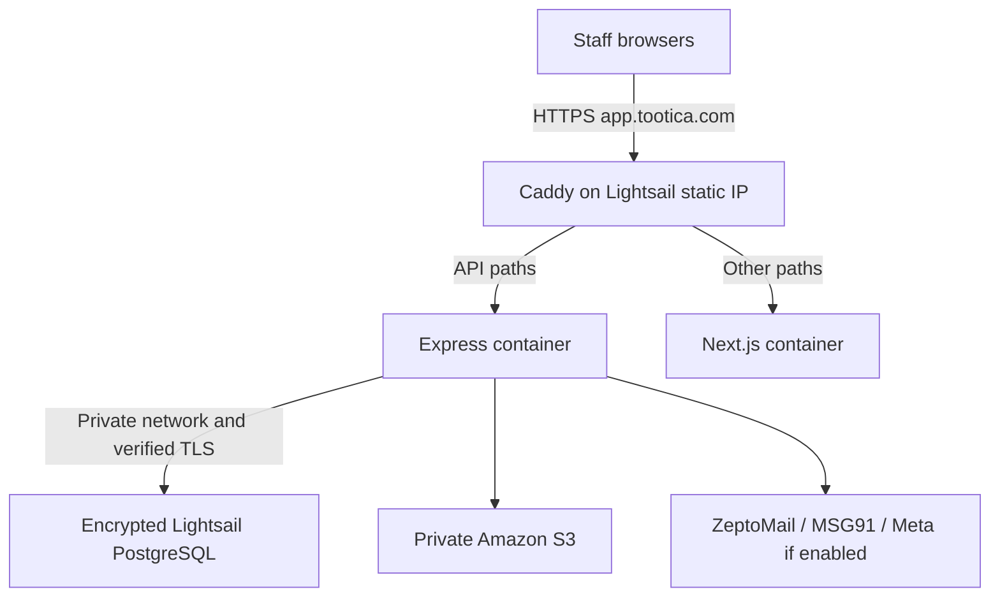

# Tootica: budget AWS Lightsail production migration

Updated **10 November 2026**. Scope: **1-3 clinics, up to 50 staff users**, Mumbai (`ap-south-1`). Monthly target: **INR 9,000-12,000**. This replaces Fargate as the selected launch plan. No AWS resources have been created by writing this guide.

For console instructions, commands and the launch sequence, follow [Move Tootica to Lightsail: step by step](AWS_LIGHTSAIL_STEP_BY_STEP.md).

## 1. Selected architecture

Start with **one 4 GB Lightsail Linux VM** for Next.js, Express and Caddy; a **separate encrypted Lightsail managed PostgreSQL database**; and **private Amazon S3** for documents/profile photos. Keep ZeptoMail and MSG91.

| Choice | Reason |
| --- | --- |
| 4 GB app server initially | Leaves cash headroom; build images elsewhere and load-test before launch |
| Separate managed PostgreSQL | Database survives app-host replacement; AWS handles database infrastructure/maintenance |
| Encrypted database tier | Use the encrypted bundle; the cheapest listed database tier has no data encryption |
| Caddy on the VM | One HTTPS origin, automatic certificates and direct API routing |
| Attached static IPv4 | Stable DNS and provider allowlist address; no NAT gateway needed |
| S3 for both file types | File persistence independent of app-host disk and a clean route to later ECS migration |

Lightsail lists the selected VM at USD 24/month and encrypted database at USD 30/month. An 8 GB VM is USD 44/month. [AWS Lightsail pricing](https://aws.amazon.com/lightsail/pricing/)

This is **not automatic high availability**. App-host failure requires repair/restore; the selected database is the standard, non-HA plan. A named person must own patches, alerts, backups and recovery. For this workload it is a reasonable budget launch if these downtime/operations responsibilities are accepted.

## 2. Budget, including a tax and communications allowance

Planning assumptions: **INR 95/USD** as a conservative conversion, **18% modeled India GST**, no free-tier discounts, modest traffic/storage, existing domain, and INR 1,000/month reserved for ZeptoMail/MSG91. This is a cash budget; it does not assume GST input credits. Actual tax/FX and provider billing must be checked against the account. [AWS India tax guidance](https://aws.amazon.com/tax-help/india/)

| Item | USD/month | Classification |
| --- | ---: | --- |
| 4 GB Lightsail app VM, public IPv4 bundle | 24.00 | Published plan |
| 2 GB encrypted managed PostgreSQL, standard plan | 30.00 | Published plan |
| Private S3 files/versions and requests | 2.00 | Allowance |
| Retained instance/manual DB snapshots | 10.00 | Allowance: 200 GB-month at the published USD 0.05/GB-month rate |
| Monitoring/logging extras | 2.00 | Allowance; built-in monitoring plus bounded logs |
| Secret storage/deployment retrieval | 2.00 | Allowance |
| Transfer/miscellaneous buffer | 3.00 | Allowance; assumes normal bundled transfer usage |
| **AWS subtotal before modeled GST** | **73.00** | |

| Monthly planning total | INR |
| --- | ---: |
| AWS at INR 95/USD | 6,935.00 |
| Modeled GST on AWS | 1,248.30 |
| AWS including modeled GST | 8,183.30 |
| Messaging reserve, including provider charges/taxes | 1,000.00 |
| **Starting monthly model** | **9,183.30** |
| **Headroom to INR 12,000** | **2,816.70** |

If load tests require the 8 GB app VM, the same model becomes **INR 11,425.30/month** including modeled GST and the same messaging reserve, leaving INR 574.70 headroom. Upgrade only if the latest forecast, provider quote and actual usage still fit the cap. Prefer the 4 GB launch to retain headroom.

[Cost spreadsheet](AWS_COST_ESTIMATE.csv) and [cost assumptions](AWS_COST_ESTIMATE_2026-11-10.json). The [earlier Fargate alternative](AWS_FARGATE_MIGRATION_REFERENCE.md) is preserved for later growth.

### Budget boundaries

- This covers recurring hosting and an illustrative messaging allowance, **not engineering fees or a paid support retainer**. SMS wallet minimums and email credit purchases may create larger cash top-ups in a particular month; confirm them before launch.
- Budget up to USD 20 for short-lived staging/rehearsal resources in the launch month. With the 4 GB model this is roughly INR 11,425.30 total. Do not combine extended staging and an 8 GB upgrade if the monthly forecast would exceed INR 12,000.
- Use bundled Lightsail DNS if suitable and Caddy TLS; no load balancer, ECS, NAT gateway, CloudFront or paid WAF is included. Preserve existing mail/DKIM DNS records.
- The attached static IP is part of the chosen VM plan; do not add the earlier Fargate plan's public-IP/NAT line items. Remove unused resources only under the backup-retention policy.
- Mumbai bundles have half the headline transfer allowance shown on the generic pricing table. Confirm the selected region/bundle before purchase. Excess traffic, S3 versions, snapshots and messaging can increase the bill. [Lightsail pricing](https://aws.amazon.com/lightsail/pricing/)
- AWS Budgets alerts are **not a hard spending stop**. Review actual/forecast bills weekly, rate-limit SMS/auth, cap uploads/storage sensibly and require approval before adding resources or upgrading.

## 3. Layout of the deployment



Only Caddy publishes ports 80/443. The Next.js/API containers use an internal Docker network; do not publish 3000/4000 or any database port to the internet. Limit SSH to approved administrator IPs and harden IPv4/IPv6 rules. Bind the static IP to the VM and use it for the app hostname and MSG91 allowlisting.

The managed database stays in **private mode**, in the same region/account as the Lightsail host. It is not a database container on the app VM. No RDS peering is needed for this selected Lightsail-to-Lightsail database design. [Private database access](https://docs.aws.amazon.com/lightsail/latest/userguide/amazon-lightsail-configuring-database-public-mode.html)
## 4. Work still required in the application

Lightsail reduces infrastructure cost and setup work; it does not make the current disk/Map implementations cloud-persistent.

### Files and images

Implement S3 selection for both `src/common/storage/fileStorage.ts` and `avatarStorage.ts`. Update the document controller's synchronous `exists()`/local stream usage to async S3 operations, retaining clinic authorization and audit records. Preserve object keys already stored in the DB, including the `avatars/<userId>/...` namespace. Keep avatar validation/resizing and failed-write/replacement cleanup. Use private S3 with Block Public Access, encryption and versioning; do not expose files as a public website.

S3 credential design must be explicit for this VM deployment. Do not assume ECS task roles or an EC2 instance profile are attached to a Lightsail Docker container. Prefer a supported temporary-credential arrangement where available; a practical launch alternative is a dedicated, tightly scoped S3 principal for this one bucket, with protected backend-only credentials and tested rotation. No root/admin AWS keys. The Lightsail bucket-instance attachment feature is for Lightsail object-storage buckets, not an automatic permission grant to an unrelated Amazon S3 bucket.

Have an authorised operator/CI identity retrieve deployment secrets. Write runtime values to root-owned protected files outside the checkout and inject only needed values into the backend. A backend S3 credential must not automatically gain administrator or secret-management access. Keep secrets out of images, Git, browser variables, command output and logs. The frontend receives no DB, JWT, SMTP or SMS secrets.

### OTP and authentication

Move OTP state to the managed PostgreSQL database, with expiry checks, hashed/HMAC codes and atomic issue/resend/attempt/one-time-consume operations. A shared get/set implementation alone does not fix concurrent read/modify/write races. Preserve the requested unmatched-phone error, with shared per-identifier/per-IP rate limits. Add password-login limits and appropriate origin/CSRF controls for cookie-authenticated mutations. Test provider failure/retry and restart behavior. This is needed even on one VM because deploys/reboots otherwise discard the Map.

### Production runtime

- Add Linux Dockerfiles and a separate production Compose configuration for Caddy, frontend and backend. The existing Compose file starts local PostgreSQL/MailHog and is not this production deployment.
- Build images in CI or on a separate builder; do not run heavy Next.js/Prisma builds on the live 4 GB VM. Install Linux dependencies and generate Prisma there, including correct Sharp binaries for the selected architecture.
- Pin reviewed image versions, run application containers as non-root, set restart policies and give Caddy persistent certificate data. Keep a separate one-shot migration image/job with Prisma CLI and PostgreSQL client tools.
- Configure `NODE_ENV=production`, exact `CORS_ORIGIN`, secure httpOnly cookies, proxy trust for the controlled Caddy hop, and `TZ=Asia/Kolkata`. Test existing local-Date business-hour logic at India day boundaries.
- Use verified database TLS with the managed database's appropriate CA/hostname settings, not disabled certificate validation. Use restricted runtime DB credentials, a separate migration role and a bounded pg pool, initially around five connections.
- Add readiness/dependency checks; existing `/health` is process-level. Fail startup for missing production S3/provider/secret configuration rather than silently using disk or console SMS.
- Disable the Next.js development API rewrite for the proxy deployment through an implemented production build switch; naming an environment setting does not implement it.

### HTTPS routing template

This Caddyfile is a template to validate after the production containers and DNS exist:

```caddyfile
app.tootica.com {
    @api path /api /api/*
    handle @api {
        reverse_proxy backend:4000
    }
    handle {
        reverse_proxy frontend:3000
    }
}
```

Use `handle`, preserving the API prefix. Confirm automatic HTTPS/renewal, forwarding headers, cookies and large uploads through the real hostname. [Caddy automatic HTTPS](https://caddyserver.com/docs/automatic-https), [routing handlers](https://caddyserver.com/docs/caddyfile/directives/handle).

## 5. Provisioning and deployment order

1. Review the release commit and approve the production dataset; do not migrate demo patients or retain development administrator passwords. Create new production JWT/deletion/provider secrets. Preserve the WhatsApp encryption key if importing existing encrypted credentials.
2. Secure the AWS account with MFA/named access. In Mumbai, verify current bundles/blueprints and select PostgreSQL 16 if offered. AWS documents PostgreSQL 16 support; confirm the actual regional option before creation. Never silently downgrade the source engine. [Engine choices](https://docs.aws.amazon.com/lightsail/latest/userguide/amazon-lightsail-choosing-a-database.html)
3. Create the selected Linux VM, attach the static IP, harden SSH/firewalls and install Docker/Compose with a documented patch/reboot procedure.
4. Create the encrypted standard managed PostgreSQL database in private mode. Set credentials/roles, validate TLS and leave automatic backups enabled. The unencrypted cheapest tier is not the selected plan.
5. Create private S3 and scoped credentials/secrets. Configure retention, versioning, file-key compatibility and tested access. Add no NAT gateway or load balancer for this initial topology.
6. Deploy reviewed images, configuration and Caddy. Only Caddy publishes ingress ports. Verify health, automatic startup after reboot and correct API routing.
7. Create application DNS to the static IP without deleting existing mail records. Configure MSG91 with the stable outgoing IP and verify ZeptoMail/SMS delivery to approved recipients.
8. Configure bounded logs, CPU/memory/disk alerts, process/endpoint checks, billing alerts and an actual incident recipient. The VM and database are burstable: monitor CPU-credit behavior, not only average utilization.
9. Rehearse on temporary resources, then remove them under retention policy. No permanent duplicate stack is included in the monthly model.

Useful read-only discovery commands, when the AWS account is connected:

```text
aws lightsail get-bundles --region ap-south-1
aws lightsail get-relational-database-bundles --region ap-south-1
aws lightsail get-relational-database-blueprints --region ap-south-1
```

### Backups and recovery

Lightsail database point-in-time restore covers the previous **seven days**, in five-minute increments. Longer retention needs manual snapshots or another protected backup process; the earlier Fargate guide's adjustable 14-day RDS policy does not carry over. [Lightsail point-in-time restore](https://docs.aws.amazon.com/lightsail/latest/userguide/amazon-lightsail-creating-a-database-from-point-in-time-backup.html)

Keep approved manual DB snapshots and automated app-host snapshots within the modeled retention allowance; monitor actual billed snapshot storage. Test restoring to a new host/database, reapplying current secrets, validating the DB endpoint and reattaching the static IP. Do not delete the last good database or backup during a resize. A move to the 8 GB VM should be rehearsed as snapshot/restore plus IP reattachment, with a maintenance window.

S3 versions, the DB and required encryption keys must be recovered consistently. Assign an operator for security updates, disk/image cleanup, backup checks and recovery; OS operations are not handled as they were by Fargate.
## 6. Migration, acceptance and launch

1. Take and verify a PostgreSQL custom-format dump plus a backup of the configured upload directory and required keys. Retain source material privately outside Git. Use PostgreSQL 16-compatible client tools.
2. On the Lightsail host or an approved private runner, validate TLS to the private managed DB, create an empty `tootica` database and the approved migration/runtime roles.
3. Restore the populated source into the empty target with `pg_restore --no-owner --no-acl --exit-on-error --dbname=tootica <archive>`, with credentials supplied securely. The full dump includes `_prisma_migrations`: restore first, then run `npm run db:migrate:deploy` and `prisma migrate status`. Do not create all tables first and collide with the full restore.
4. Preserve object keys when copying the upload root contents to S3. Pre-copy larger sets; final-sync after freezing writes. Verify DB references, object counts/bytes and downloaded-content/checksum checks, not just a successful copy exit code.
5. Test password/OTP login, cross-restart OTP verification, limits, email/SMS, clinic/branch isolation, appointments/conflicts/India day boundaries, five treatment favourites, photos, documents and optional WhatsApp.
6. Load-test about 10 concurrently active staff and a short 25-session burst, including photo processing and 25 MB documents. These are acceptance scenarios, not a performance claim. Monitor RAM, swapping, CPU credits, disk and DB connections. Use 8 GB only if the tested requirement and complete bill forecast fit the cap.
7. Restore backups into a test environment and verify usable records/files. Reboot the app host and verify automatic recovery. Record actual restore and cutover times.
8. For cutover, agree a measured maintenance window, stop all old writers, take the final dump/file delta, restore/apply pending migrations/sync/check, switch DNS/static-IP endpoint, and open writes on only the new system. Start with one accepted real appointment before opening all clinics.
9. Closely observe the first 48 hours. Track the actual bill and tear down temporary staging resources. Never run development seeds, `db:provision` or `db:reset` on production.

**Rollback:** before new writes, returning to the frozen source is possible after state checks. After production writes, do not point clients at an older DB. Prefer reverting app images with the current DB/S3 state when schema-compatible. A full fallback requires another write freeze and reconciliation/restoration of the latest data and files. Use backward-compatible migrations and keep one writable source of truth.

## 7. Realistic delivery estimate

| Work | Engineer hours |
| --- | ---: |
| Access/release/dataset/backup decisions | 4 |
| S3 documents and avatars | 12-16 |
| Persistent atomic OTPs and auth limits | 12-16 |
| Linux images, Compose and HTTPS | 6-8 |
| VM/private DB, secrets and monitoring | 5-6 |
| Migration rehearsal | 4-6 |
| Restore/load/functional acceptance | 8-12 |
| Cutover and handoff | 4-6 |
| Rework/decision buffer | 1-6 |
| **Total** | **56-80 hours** |

Plan **7-10 working days**, subject to AWS/domain/provider access and test findings. Lightsail is quicker to provision, but the S3 and OTP changes are still required. One-time implementation fees and continuing support labour are separate from the monthly hosting budget.

## 8. Go-live checklist

- [ ] Selected bundles and private encrypted PostgreSQL verified in Mumbai.
- [ ] Latest forecast includes actual tax, FX, communication purchases and temporary staging, and fits INR 12,000.
- [ ] Reviewed Linux images, dependencies, Caddy TLS, firewall rules and boot recovery.
- [ ] Real S3 adapters, scoped credentials, authorization and file migration validated.
- [ ] Persistent atomic OTPs, authentication limits and actual messaging delivery tested.
- [ ] Private DB roles/TLS, migration history and runtime connection limits verified.
- [ ] Clinic isolation, bookings, treatments, photos and documents accepted under realistic load.
- [ ] VM/DB/S3 recovery rehearsed; named operator accepts patching and downtime responsibilities.
- [ ] Single writable production system, monitoring, budget alerts and first-week cost review established.

No AWS provisioning or application storage/OTP rewrite is performed by creating this document. The archived Fargate plan remains a future option; it is not required for this Lightsail launch.